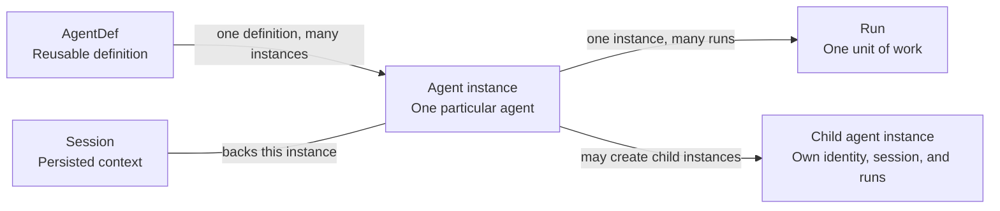

# Definitions, instances, sessions, and runs

*This chapter illustrates the proposed identity model. The registration API and
storage representation remain implementation decisions.*

An agent definition can be reused by many agent instances. Each instance has its
own identity and persisted context, and can perform several runs over its lifetime.

Here, *Session* means the persisted context for one agent instance. A child has
its own child Session. The root session and its children form the wider session
tree. Each child follows the same relationships shown for the parent instance,
and can use a different selected definition.

An **AgentDef** describes how an agent should work. Trusted lifecycle code selects
definitions before the main instance begins execution. Selecting a definition
does not create another agent instance. The selected source and revision stay
fixed for the session; [agent definitions](agent-definitions.md) explains admission
and provenance.

An **agent instance** is one particular use of a selected definition. Alice and
Bob can both use `code-reviewer`, but their reviewers are distinct instances. A
root instance has no creation parent; a child has one creation-parent link.
Restoring an instance preserves that identity and association.

A **Run** is one unit of work performed by an instance. Reviewing PR 42 and later
reviewing PR 57 can use the same reviewer instance in separate runs. Pausing for
approval and resuming continues the same run, including after restoration.

| Event | Instance identity | Run |
| --- | --- | --- |
| Start a new root session | Create a new main instance. | New work starts a run. |
| Assign more work to an existing instance | Keep the same instance and selected definition. | Start another run. |
| Create a child agent | Create a distinct instance with its own Session and a creation-parent link. | The child's work has its own run. |
| Pause and resume unfinished work | Keep the same instance. | Continue the existing run. |
| Restore after a process restart | Recover the original instance, selected definition, and creation-parent link. | Continue a recoverable unfinished run; later work starts a new run. |

Creation ancestry and execution delegation describe different relationships. The
creation-parent link records which instance created a child. A delegation links
the run assigning work to the run performing it. The child's identity remains
stable across its runs; each run supplies its own execution context. See
[registering instances](agent-definitions.md#registering-instances).

The [domain model](../../architecture/mecatl.modelith.md) provides the broader
execution model. This view focuses on the relationships needed to understand
agent identity and continuity.
